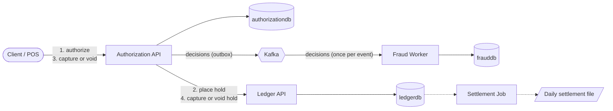
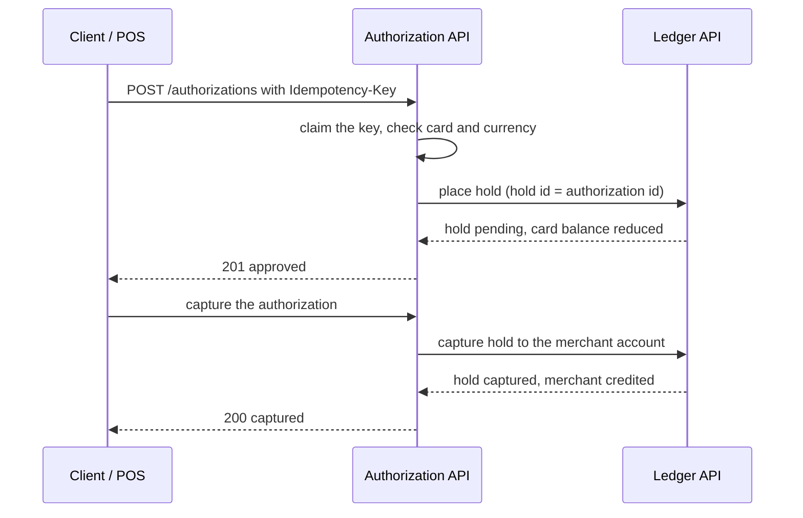

# Card Transaction Platform

[](https://github.com/renato-aq/card-transaction-platform/actions/workflows/ci.yml)

An event-driven card transaction platform built with **.NET 10** and **.NET Aspire**: real-time authorization,
a double-entry ledger, asynchronous fraud detection and a high-volume daily settlement batch.

> **Status:** work in progress. See the [roadmap](#roadmap).

## Architecture



Solid arrows are implemented; dotted arrows are the next phases (see the [roadmap](#roadmap)). A purchase is
**authorized** first, which places a **hold** on the card balance in the Ledger, and **captured** (the money goes to
the merchant) or **voided** (the money goes back to the card) later; see [Authorization](#authorization).

| Service | Responsibility |
|---|---|
| **Authorization API** | Approves or declines card purchases with low latency, idempotent by `Idempotency-Key`; captures and voids them |
| **Ledger API** | Double-entry bookkeeping, balances and authorization holds; transactional outbox for events (planned) |
| **Fraud Worker** | Consumes the authorization events idempotently into a purchase history per card; flags suspicious purchases on `fraud-signals` |
| **Settlement Job** | Generates the daily settlement file in batches from the ledger |

Shared projects: `ServiceDefaults` (OpenTelemetry, health checks, resilience, service discovery), `Contracts`
(integration events) and `Messaging` (transactional outbox and its Kafka publisher, and the idempotent Kafka consumer,
used by the services' Infrastructure layers).

## Tech stack

- **.NET 10**, ASP.NET Core, Entity Framework Core
- **.NET Aspire** for local orchestration and observability dashboard
- **PostgreSQL**, **Kafka**
- **OpenTelemetry** (traces, metrics, logs)
- **xUnit**, WebApplicationFactory, Testcontainers
- **GitHub Actions** CI

## Getting started

Prerequisites:

- [.NET 10 SDK](https://dotnet.microsoft.com/download)
- A container runtime: [Docker Desktop](https://www.docker.com/products/docker-desktop/) or [OrbStack](https://orbstack.dev/)

Run the whole platform (PostgreSQL, Kafka and all services) with one command:

```bash
dotnet run --project src/CardPlatform.AppHost
```

Or, with the [Aspire CLI](https://aspire.dev) installed, from the repository root:

```bash
aspire run
```

The Aspire dashboard URL is printed in the console. Kafka UI is available from the dashboard.

Run the tests (the Ledger and Authorization API integration tests use [Testcontainers](https://testcontainers.com/) to start a
real PostgreSQL, so the container runtime must be running; the Authorization integration tests also run the real Ledger
API in process, with its own database, and the outbox publisher, consumer, Fraud Worker and end-to-end tests also start a Kafka broker):

```bash
dotnet test
```

## Ledger

The Ledger is the source of truth for balances. It follows a **hexagonal architecture** with **pragmatic CQRS**
([ADR 0004](docs/adr/0004-use-hexagonal-architecture-with-pragmatic-cqrs.md)), split into projects so the compiler
enforces the dependency rule (checked by architecture tests):

| Project | What lives there | Depends on |
|---|---|---|
| `Ledger.Domain` | `Account`, `LedgerTransaction`, `Entry`, `Hold`, `Money` and the invariants | nothing |
| `Ledger.Application` | Command/query handlers, ports (repositories, unit of work), retry decorator | Domain |
| `Ledger.Infrastructure` | EF Core + PostgreSQL adapters, migrations, query implementations | Application |
| `Ledger.Api` | Minimal API endpoints, `Result` → `ProblemDetails`, composition root | Application, Infrastructure |

- **Commands** (open account, post transaction, place/capture/void a hold) go through the domain model, which
  enforces the rules; **queries** (balance, hold) read the database directly into DTOs. One database, no mediator
  library.
- **Double-entry** ([ADR 0005](docs/adr/0005-use-double-entry-ledger-model.md)): every transaction has debits equal to
  credits and every account uses `balance = credits − debits`, so the sum of all balances is always zero.
  Account types are `settlement`, `card`, `merchant` and `holds`. A top-up debits `settlement` and credits `card`; a
  direct purchase debits `card` and credits `merchant`. A card balance can never go negative.
- **Holds** ([ADR 0007](docs/adr/0007-model-authorization-holds-in-the-ledger.md)): an authorized purchase is a hold,
  also modelled as double-entry. Placing it debits `card` and credits the `holds` account of the currency (one per
  currency, created on first use); capturing it debits `holds` and credits `merchant`; voiding it debits `holds` and credits
  `card` back. So the card balance is always the available balance, and a hold goes `pending` → `captured` or `voided`, both final
  (otherwise `hold_not_pending`). Holds are idempotent by id: placing the same hold again returns the existing one.
- **Optimistic concurrency** ([ADR 0006](docs/adr/0006-use-optimistic-concurrency-for-ledger-accounts.md)): the
  PostgreSQL `xmin` column is the concurrency token of each account. On a conflict, posting a transaction or
  placing, capturing or voiding a hold is retried up to 3 times with jittered backoff; if it still conflicts the API
  answers `409` with `code: concurrency_conflict`. Holds use the same token, so a hold cannot be captured and voided
  at the same time.

### Ledger API

With the platform running, the Ledger API listens on `http://localhost:5211` (the `http` endpoint of `ledger-api`
in the Aspire dashboard, also shown by `aspire describe ledger-api`). In Development, the OpenAPI document is at
`/openapi/v1.json`. The examples below use `curl` and [jq](https://jqlang.org/) to capture the account ids:

```bash
LEDGER=http://localhost:5211
```

Open a settlement, a card and a merchant account:

```bash
SETTLEMENT=$(curl -s -X POST "$LEDGER/accounts" -H 'Content-Type: application/json' \
  -d '{"type":"settlement","currency":"BRL"}' | jq -r .id)
CARD=$(curl -s -X POST "$LEDGER/accounts" -H 'Content-Type: application/json' \
  -d '{"type":"card","currency":"BRL"}' | jq -r .id)
MERCHANT=$(curl -s -X POST "$LEDGER/accounts" -H 'Content-Type: application/json' \
  -d '{"type":"merchant","currency":"BRL"}' | jq -r .id)
```

Each call answers `201 Created` with `Location: /accounts/{id}` and the new account:

```json
{"id":"<id>","type":"card","currency":"BRL","balance":{"amount":0.00,"currency":"BRL"}}
```

Top up the card with 100 (debit settlement, credit card):

```bash
curl -s -X POST "$LEDGER/transactions" -H 'Content-Type: application/json' -d '{
  "description": "Top-up",
  "currency": "BRL",
  "entries": [
    { "accountId": "'"$SETTLEMENT"'", "direction": "debit", "amount": 100.00 },
    { "accountId": "'"$CARD"'", "direction": "credit", "amount": 100.00 }
  ]
}'
```

Buy something for 30 (debit card, credit merchant):

```bash
curl -s -X POST "$LEDGER/transactions" -H 'Content-Type: application/json' -d '{
  "description": "Coffee shop",
  "currency": "BRL",
  "entries": [
    { "accountId": "'"$CARD"'", "direction": "debit", "amount": 30.00 },
    { "accountId": "'"$MERCHANT"'", "direction": "credit", "amount": 30.00 }
  ]
}'
```

Both answer `201 Created` with the posted transaction:

```json
{"id":"<id>","description":"Coffee shop","currency":"BRL","createdAt":"<timestamp>","entries":[{"accountId":"<card>","direction":"debit","amount":30.00},{"accountId":"<merchant>","direction":"credit","amount":30.00}]}
```

Get the card balance:

```bash
curl -s "$LEDGER/accounts/$CARD/balance"
```

```json
{"accountId":"<card>","balance":{"amount":70.00,"currency":"BRL"}}
```

Errors are `application/problem+json` with a machine-readable `code`: `400` for invalid input (e.g.
`invalid_amount`, `invalid_currency`), `404` `account_not_found`, `422` for business rules
(`unbalanced_transaction`, `currency_mismatch`, `insufficient_funds`, `hold_not_pending`, `not_a_merchant_account`)
and `409` (`concurrency_conflict`, `hold_id_conflict`).
For example, spending more than the card holds:

```bash
curl -s -X POST "$LEDGER/transactions" -H 'Content-Type: application/json' -d '{
  "currency": "BRL",
  "entries": [
    { "accountId": "'"$CARD"'", "direction": "debit", "amount": 500.00 },
    { "accountId": "'"$MERCHANT"'", "direction": "credit", "amount": 500.00 }
  ]
}'
```

`422 Unprocessable Entity`, `Content-Type: application/problem+json`:

```json
{
  "type": "https://tools.ietf.org/html/rfc4918#section-11.2",
  "title": "Business rule violated",
  "status": 422,
  "detail": "Account <card> has a balance of 70.00 BRL and cannot be debited 500.00 BRL.",
  "code": "insufficient_funds",
  "traceId": "<trace id>"
}
```

The hold endpoints (`POST /holds`, `GET /holds/{id}`, `POST /holds/{id}/capture` with a `merchantAccountId`,
`POST /holds/{id}/void`) are called by the Authorization API; the [Authorization API examples](#authorization-api)
show them at work.

## Authorization

The Authorization approves or declines card purchases and later captures or voids them. It keeps its own cards and
authorizations in its own database (`authorizationdb`) and leaves the money to the Ledger: an approved purchase is a
hold in the Ledger ([ADR 0007](docs/adr/0007-model-authorization-holds-in-the-ledger.md)). It uses the same layering
as the Ledger ([ADR 0004](docs/adr/0004-use-hexagonal-architecture-with-pragmatic-cqrs.md)):

| Project | What lives there | Depends on |
|---|---|---|
| `Authorization.Domain` | `Card`, `CardAuthorization`, decline reasons, `Money` and the invariants | nothing |
| `Authorization.Application` | Command/query handlers, idempotency rules, ports (repositories, idempotency key store, `ILedgerClient`, outbox), event mapping | Domain, Contracts |
| `Authorization.Infrastructure` | EF Core + PostgreSQL adapters, migrations, outbox, Ledger HTTP client | Application |
| `Authorization.Api` | Minimal API endpoints, `Idempotency-Key` header, `Result` → `ProblemDetails`, composition root | Application, Infrastructure |



- **Idempotency** ([ADR 0008](docs/adr/0008-make-purchase-authorization-idempotent.md)): every purchase carries an
  `Idempotency-Key` header, unique per purchase. The key is claimed in `authorizationdb` before anything else and gets
  an authorization id reserved for it, which is also the hold id. The same key with the same body replays the recorded
  response byte for byte, without a second hold; the same key with a different body is `422` `idempotency_key_reused`;
  while the first request is still running the answer is `409` `idempotency_request_in_progress`. Only authorizations
  (approved or declined) are recorded. After a `400` or `404` the key is released; after a `503` the next request with
  the key processes the purchase again with the same reserved id, so the Ledger returns the hold it may already have
  instead of placing a second one.
- **Declines** are business outcomes, not HTTP errors: an approved and a declined purchase both answer `201` and are
  recorded. Checks run in this order: input validation (`400`), card exists (`404` `card_not_found`), card active
  (declined `card_blocked`), currency equals the card's (declined `currency_mismatch`), hold placed in the Ledger
  (declined `insufficient_funds`). The merchant account is only checked for format at this point; the Ledger checks it
  on capture.
- **Capture and void** close an `approved` authorization: capture moves the held amount to its merchant account, void
  returns it to the card. They are not idempotent in the Ledger, so when an earlier attempt did reach the Ledger but its
  answer was lost, the next attempt gets `hold_not_pending`; the Authorization then reads the hold and **reconciles**:
  if the hold was completed the same way, the authorization is marked so and the call succeeds; if it was completed the
  other way, the authorization takes that status and the call is `422`. Retrying a capture or void is therefore safe
  without an idempotency key.
- **Events** ([ADR 0010](docs/adr/0010-publish-integration-events-through-a-transactional-outbox.md)): every decision
  (approved, declined, captured, voided) is written to the `outbox_messages` table in the same transaction as the
  authorization, and a background publisher sends it to the Kafka topic `authorizations`, keyed by card id, marking
  it published only after the broker acknowledged it. If Kafka is down, events wait in the outbox and are published,
  in order per card, when it is back. Delivery is at least once, so consumers deduplicate by event id. In Development
  the topics are created on startup (3 partitions each); `Messaging:Outbox:Enabled=false` turns publishing off.
- **Fraud signals** ([ADR 0011](docs/adr/0011-consume-integration-events-idempotently.md)): the Authorization consumes
  `fraud-signals` (consumer group `authorization-api`) and a `FraudSuspected` **blocks the card** through the same
  idempotent block command, once per event id; its next purchases are declined with `card_blocked`. The suspicion
  (rule and reason) is logged, and `GET /cards/{id}` is unchanged; a suspicion of an unknown card is logged and
  skipped. `Messaging:Consumer:Enabled=false` turns consuming off.

## Fraud Worker

The Fraud Worker consumes the topic `authorizations` (consumer group `fraud-worker`) and records every decision in a
purchase history per card in its own database (`frauddb`), the input of the fraud rules. Each event is
processed **once per event id**: the event id is written to `processed_messages` in the same transaction as the
history, so a redelivered or duplicated event is skipped, and the Kafka offset is committed only after that
transaction ([ADR 0011](docs/adr/0011-consume-integration-events-idempotently.md)). Event types it does not know are
logged and ignored. It uses the same layering as the other services
([ADR 0004](docs/adr/0004-use-hexagonal-architecture-with-pragmatic-cqrs.md)), with `Fraud.Worker` as the host.

Every newly recorded **approved** purchase is judged by two rules in the Fraud domain, against the card's history up
to the purchase's own authorization time (not the processing time, so a replay judges it the same way):

| Rule (`rule` code) | Fires when | Default (`Fraud:Rules`) |
|---|---|---|
| Velocity (`velocity`) | the card has N or more approved purchases, this one included, in `(t − window, t]` | `Velocity:Threshold=5`, `Velocity:Window=00:01:00` |
| Amount above average (`amount_above_average`) | the amount is greater than X times the average of the card's previous approved purchases **in the same currency**, given at least M of them | `AmountAboveAverage:Multiplier=3`, `AmountAboveAverage:MinimumHistory=5` |

Declined purchases never count; captured and voided ones count as approved. The limits are validated on startup. A
purchase that fires any rule raises one `FraudSuspected` (card, authorization, rule, reason; both rules are joined as
`velocity,amount_above_average` with both reasons), written to the Fraud Worker's `outbox_messages` in the same
transaction as the purchase and the processed mark, and published on `fraud-signals` (key = card id) by the same
outbox publisher as the Authorization's. Its event id is derived from the authorization id, and a purchase is judged
only when its approval is first recorded, so an authorization raises at most one suspicion
([ADR 0012](docs/adr/0012-judge-purchases-by-fraud-rules-at-approval.md)).

### Retries and dead-letter topics

Both consumers (the Fraud Worker on `authorizations`, the Authorization on `fraud-signals`) handle failures the same
way ([ADR 0011, amendment](docs/adr/0011-consume-integration-events-idempotently.md)). A temporary failure (e.g. the
database is down) is retried in process with exponential backoff, before any later message of the same partition, up to
`Messaging:Consumer:MaxAttempts` attempts (default 5; `RetryInitialDelay` 1 s doubling up to `RetryMaxDelay` 30 s). A
permanent failure (a message that is not a valid event envelope, or an event the service rejects, e.g. an invalid
currency) and a message that ran out of attempts go to `<topic>.dlt` (`authorizations.dlt`, `fraud-signals.dlt`;
created on startup in Development). The offset is committed only after the dead-letter topic acknowledged the message,
so nothing is lost and the partition moves on; each dead-lettered message is logged as an error.

A dead-lettered message keeps its original key, value (byte for byte) and headers, plus:

| Header | Value |
|---|---|
| `dlt-reason` | the error message (up to 1000 characters) |
| `dlt-exception-type` | e.g. `System.Text.Json.JsonException` |
| `dlt-failure-kind` | `permanent` or `retries-exhausted` |
| `dlt-attempts` | how many times it was processed |
| `dlt-original-topic`, `dlt-original-partition`, `dlt-original-offset` | where it came from |
| `dlt-consumer-group` | the consumer group that gave up on it |
| `dlt-failed-at` | when (UTC, ISO 8601) |

To inspect them, open Kafka UI from the Aspire dashboard, pick the `.dlt` topic and look at the messages with their
headers. Reprocessing is manual: once the cause is fixed, produce the message's key and value again to the original
topic, to the partition in `dlt-original-partition` (so it stays with the other events of its card): e.g. with Kafka
UI's "Produce message" (copy key and value, choose the partition), or with a CLI such as
`kcat -C -b <broker> -t authorizations.dlt -o <offset> -c 1 -e -f '%k\t%s\n'` piped into
`kcat -P -b <broker> -t authorizations -p <partition> -K '\t'` (the values are single-line JSON). Replays are safe: a
dead-lettered event was not marked as processed, so it is processed normally, and an event that was processed is
skipped by its event id.

### When the Ledger is down

The Authorization talks to the Ledger through the `ILedgerClient` port, implemented by a typed `HttpClient` whose base
address `https+http://ledger-api` is resolved by Aspire service discovery. `ServiceDefaults` adds a standard resilience
handler with generic settings to every `HttpClient`; for the Ledger client that handler is **replaced** by a standard
handler tuned for authorization calls (section `Ledger` in configuration, see `LedgerClientOptions`;
[ADR 0009](docs/adr/0009-fail-fast-when-the-ledger-is-unavailable.md)):

| Setting | Value | Why |
|---|---|---|
| Total timeout | 2 s | a card authorization cannot wait long; the whole call, retries included, fits in it |
| Attempt timeout | 1 s | a slow attempt is abandoned while there is still budget for a retry |
| Retries | 2, exponential backoff from 100 ms with jitter | only for calls that are safe to repeat (see below) |
| Circuit breaker | standard defaults (opens at ≥ 10% failures over ≥ 100 attempts in 30 s, for 5 s) | stops hammering a Ledger that is down |

With these budgets, an attempt that times out leaves room for only one retry; both retries are used only by fast
failures (a `5xx`, a refused connection). Only safe calls are retried: reads (balance, hold) and placing a hold, which
is idempotent by hold id. Opening an account, capturing and voiding are never retried by the client: repeating them
would open a second account or fail with `hold_not_pending` (which the reconciliation above handles).

When the Ledger is down or slow (timeout, open circuit, connection error or a `5xx` after the retries), the
Authorization API answers `503 Service Unavailable` with `code: ledger_unavailable` within about 2 seconds instead of
hanging, and records nothing: no card is saved, no purchase is recorded (the idempotency key keeps its reserved id for
the retry), and a capture or void leaves the authorization `approved`. Errors returned by the Ledger keep their code
(e.g. `account_not_found`, `not_a_merchant_account`).

### Authorization API

With the platform running, the Authorization API listens on `http://localhost:5272` (the `http` endpoint of
`authorization-api` in the Aspire dashboard). The examples continue from the [Ledger API](#ledger-api) ones: they use
`$LEDGER` and the `$SETTLEMENT` account to load the card, and open a new merchant account to be paid:

```bash
AUTHZ=http://localhost:5272
MERCHANT_ID=$(curl -s -X POST "$LEDGER/accounts" -H 'Content-Type: application/json' \
  -d '{"type":"merchant","currency":"BRL"}' | jq -r .id)
```

Create a card. `POST /cards` opens the card's account in the Ledger, then saves the card (status `active`):

```bash
CARD_JSON=$(curl -s -X POST "$AUTHZ/cards" -H 'Content-Type: application/json' -d '{"currency":"BRL"}')
CARD_ID=$(echo "$CARD_JSON" | jq -r .id)
CARD_ACCOUNT=$(echo "$CARD_JSON" | jq -r .ledgerAccountId)
```

`201 Created`, `Location: /cards/{id}`:

```json
{"id":"<id>","ledgerAccountId":"<ledger account id>","currency":"BRL","status":"active"}
```

Load 100 into the card through the Ledger (debit settlement, credit the card's account):

```bash
curl -s -X POST "$LEDGER/transactions" -H 'Content-Type: application/json' -d '{
  "description": "Card load",
  "currency": "BRL",
  "entries": [
    { "accountId": "'"$SETTLEMENT"'", "direction": "debit", "amount": 100.00 },
    { "accountId": "'"$CARD_ACCOUNT"'", "direction": "credit", "amount": 100.00 }
  ]
}'
```

Authorize a purchase of 30 with a new `Idempotency-Key`:

```bash
KEY=$(uuidgen)
PURCHASE="{\"cardId\":\"$CARD_ID\",\"merchantAccountId\":\"$MERCHANT_ID\",\"amount\":30.00,\"currency\":\"BRL\"}"
AUTH=$(curl -s -X POST "$AUTHZ/authorizations" -H 'Content-Type: application/json' \
  -H "Idempotency-Key: $KEY" -d "$PURCHASE")
echo "$AUTH"
AUTH_ID=$(echo "$AUTH" | jq -r .id)
```

`201 Created`, `Location: /authorizations/{id}`:

```json
{"id":"<id>","status":"approved","declineReason":null,"cardId":"<card id>","merchantAccountId":"<merchant id>","amount":30.00,"currency":"BRL","createdAt":"<timestamp>","completedAt":null}
```

Send the same purchase again with the same key, as a POS would after a timeout. The answer is the same `201` with
exactly the same body (same id), and no second hold is placed:

```bash
curl -s -X POST "$AUTHZ/authorizations" -H 'Content-Type: application/json' \
  -H "Idempotency-Key: $KEY" -d "$PURCHASE"
```

The same key with a different body is rejected with `422` `idempotency_key_reused`:

```bash
curl -s -X POST "$AUTHZ/authorizations" -H 'Content-Type: application/json' -H "Idempotency-Key: $KEY" \
  -d "{\"cardId\":\"$CARD_ID\",\"merchantAccountId\":\"$MERCHANT_ID\",\"amount\":50.00,\"currency\":\"BRL\"}"
```

The 30 are held, so the card balance in the Ledger is now 70:

```bash
curl -s "$LEDGER/accounts/$CARD_ACCOUNT/balance"
```

```json
{"accountId":"<card account>","balance":{"amount":70.00,"currency":"BRL"}}
```

Capture the authorization (no body). The held 30 go to the merchant account:

```bash
curl -s -X POST "$AUTHZ/authorizations/$AUTH_ID/capture"
curl -s "$LEDGER/accounts/$MERCHANT_ID/balance"
```

`200 OK` with the authorization, now `"status":"captured"` with a `completedAt` timestamp; the merchant balance is 30
and the card balance stays 70. `GET /authorizations/{id}` returns the same authorization.

A second purchase, this time voided: the held 20 go back to the card, whose balance returns to 70:

```bash
AUTH2_ID=$(curl -s -X POST "$AUTHZ/authorizations" -H 'Content-Type: application/json' \
  -H "Idempotency-Key: $(uuidgen)" \
  -d "{\"cardId\":\"$CARD_ID\",\"merchantAccountId\":\"$MERCHANT_ID\",\"amount\":20.00,\"currency\":\"BRL\"}" | jq -r .id)
curl -s -X POST "$AUTHZ/authorizations/$AUTH2_ID/void"
curl -s "$LEDGER/accounts/$CARD_ACCOUNT/balance"
```

A purchase above the balance is declined, still with `201` and recorded:

```bash
curl -s -X POST "$AUTHZ/authorizations" -H 'Content-Type: application/json' -H "Idempotency-Key: $(uuidgen)" \
  -d "{\"cardId\":\"$CARD_ID\",\"merchantAccountId\":\"$MERCHANT_ID\",\"amount\":500.00,\"currency\":\"BRL\"}"
```

```json
{"id":"<id>","status":"declined","declineReason":"insufficient_funds","cardId":"<card id>","merchantAccountId":"<merchant id>","amount":500.00,"currency":"BRL","createdAt":"<timestamp>","completedAt":null}
```

Block the card (blocking a card that is already blocked also succeeds) and read it back; both answer `200 OK` with
`"status":"blocked"`, and from now on its purchases are declined with `card_blocked`:

```bash
curl -s -X POST "$AUTHZ/cards/$CARD_ID/block"
curl -s "$AUTHZ/cards/$CARD_ID"
```

Errors are `application/problem+json` with a machine-readable `code`:

| Status | Codes |
|---|---|
| `400` | `idempotency_key_required`, `invalid_idempotency_key`, `invalid_card_id`, `invalid_merchant_account_id`, `invalid_currency`, `invalid_amount`, `too_many_decimal_places` |
| `404` | `card_not_found`, `authorization_not_found`, `account_not_found` (unknown merchant account, on capture) |
| `409` | `idempotency_request_in_progress` |
| `422` | `idempotency_key_reused`, `authorization_not_capturable`, `authorization_not_voidable`, `not_a_merchant_account` (on capture) |
| `503` | `ledger_unavailable` |

Only `approved` authorizations can be captured or voided: a declined, captured or voided one is `422`
`authorization_not_capturable` / `authorization_not_voidable` and the Ledger is not called.

## Project structure

```
src/
  CardPlatform.AppHost/               Aspire orchestration
  CardPlatform.ServiceDefaults/       Shared observability, health checks, resilience
  CardPlatform.Contracts/             Integration events
  CardPlatform.Messaging/             Transactional outbox (outbox_messages), its Kafka publisher and the idempotent consumer (processed_messages)
  CardPlatform.Authorization.Domain/         Authorization entities and invariants
  CardPlatform.Authorization.Application/    Authorization use cases and ports
  CardPlatform.Authorization.Infrastructure/ EF Core, PostgreSQL (authorizationdb), migrations, outbox, Ledger HTTP client
  CardPlatform.Authorization.Api/            Authorization HTTP endpoints
  CardPlatform.Ledger.Domain/         Ledger entities, value objects and invariants
  CardPlatform.Ledger.Application/    Ledger use cases (command/query handlers) and ports
  CardPlatform.Ledger.Infrastructure/ EF Core, PostgreSQL, migrations
  CardPlatform.Ledger.Api/            Ledger HTTP endpoints
  CardPlatform.Fraud.Domain/         Fraud entities, invariants and fraud rules
  CardPlatform.Fraud.Application/    Fraud use cases and ports
  CardPlatform.Fraud.Infrastructure/ EF Core, PostgreSQL (frauddb), migrations, authorization event handlers
  CardPlatform.Fraud.Worker/         Fraud Worker host (composition root)
  CardPlatform.Settlement.Job/
tests/
  CardPlatform.Architecture.Tests/    Dependency rule between the Ledger, Authorization and Fraud layers
  CardPlatform.Ledger.Domain.Tests/
  CardPlatform.Ledger.Application.Tests/
  CardPlatform.Ledger.Api.Tests/      Integration tests (WebApplicationFactory + Testcontainers PostgreSQL)
  CardPlatform.Authorization.Domain.Tests/
  CardPlatform.Authorization.Application.Tests/
  CardPlatform.Authorization.Infrastructure.Tests/ Ledger client against a fake Ledger (retries, timeouts, circuit), fraud signal handler
  CardPlatform.Authorization.Api.Tests/ Integration tests (WebApplicationFactory + Testcontainers PostgreSQL, Ledger API in process)
  CardPlatform.Fraud.Domain.Tests/
  CardPlatform.Fraud.Application.Tests/
  CardPlatform.Fraud.Worker.Tests/    Worker host against Testcontainers PostgreSQL and Kafka (migrations, idempotent consumption, fraud signals)
  CardPlatform.Messaging.Tests/       Outbox publisher and consumer against Testcontainers PostgreSQL and Kafka
  CardPlatform.EndToEnd.Tests/        Authorization, Ledger and Fraud Worker in process against Testcontainers PostgreSQL and Kafka
docs/adr/                             Architecture Decision Records
```

## Roadmap

- [x] Solution skeleton, Aspire orchestration, CI
- [x] Ledger: double-entry accounts and transactions (EF Core + PostgreSQL)
- [x] Authorization API: idempotent authorization flow with holds, capture and void
- [ ] Transactional outbox + Kafka integration events
- [ ] Fraud Worker: rule-based detection
- [ ] Settlement Job: batched file generation with before/after benchmarks
- [ ] Integration tests with Testcontainers
- [ ] Load tests with k6 and published results
- [ ] Kubernetes manifests

## Architecture decisions

See [docs/adr](docs/adr) for the reasoning behind the main technical choices:

1. [Record architecture decisions](docs/adr/0001-record-architecture-decisions.md)
2. [Use .NET Aspire for local orchestration](docs/adr/0002-use-dotnet-aspire-for-local-orchestration.md)
3. [Use Kafka for integration events and PostgreSQL for the ledger](docs/adr/0003-use-kafka-and-postgresql.md)
4. [Use hexagonal architecture with pragmatic CQRS](docs/adr/0004-use-hexagonal-architecture-with-pragmatic-cqrs.md)
5. [Use a double-entry ledger model](docs/adr/0005-use-double-entry-ledger-model.md)
6. [Use optimistic concurrency for ledger accounts](docs/adr/0006-use-optimistic-concurrency-for-ledger-accounts.md)
7. [Model authorization holds in the ledger](docs/adr/0007-model-authorization-holds-in-the-ledger.md)
8. [Make purchase authorization idempotent](docs/adr/0008-make-purchase-authorization-idempotent.md)
9. [Fail fast when the Ledger is unavailable](docs/adr/0009-fail-fast-when-the-ledger-is-unavailable.md)
10. [Publish integration events through a transactional outbox](docs/adr/0010-publish-integration-events-through-a-transactional-outbox.md)
11. [Consume integration events idempotently](docs/adr/0011-consume-integration-events-idempotently.md)
