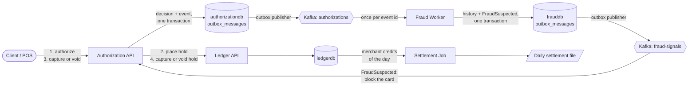
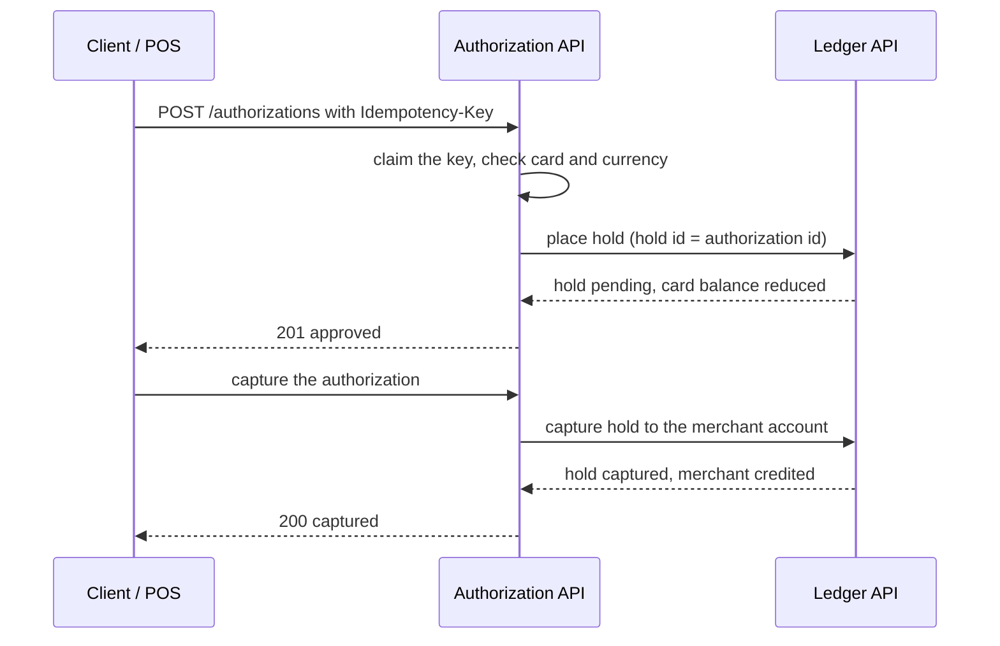

# Card Transaction Platform

[](https://github.com/renato-aq/card-transaction-platform/actions/workflows/ci.yml)

An event-driven card transaction platform built with **.NET 10** and **.NET Aspire**: real-time authorization,
a double-entry ledger, asynchronous fraud detection and a high-volume daily settlement batch.

> **Status:** work in progress. See the [roadmap](#roadmap).

## Architecture



A purchase is **authorized** first, which places a **hold** on the card balance in the Ledger, and **captured** (the
money goes to the merchant) or **voided** (the money goes back to the card) later; see [Authorization](#authorization).
Every decision is also an event: it is saved in the Authorization's outbox with the decision and published to Kafka,
the Fraud Worker judges each approved purchase by its [fraud rules](#fraud-worker), and a suspicion comes back as a
`FraudSuspected` event that blocks the card; see [Events and messaging](#events-and-messaging). The Settlement Job, a
batch started on demand, reads one day's credits to merchant accounts from `ledgerdb` and writes them to a fixed-width
settlement file; see [Settlement Job](#settlement-job).

| Service | Responsibility |
|---|---|
| **Authorization API** | Approves or declines card purchases with low latency, idempotent by `Idempotency-Key`; captures and voids them; publishes every decision; blocks cards on `FraudSuspected` |
| **Ledger API** | Double-entry bookkeeping, balances and authorization holds |
| **Fraud Worker** | Consumes the authorization events idempotently into a purchase history per card; flags suspicious purchases on `fraud-signals` |
| **Settlement Job** | Batch started on demand: writes the daily settlement file of the merchants' credits from the ledger, streaming it page by page, optionally in parallel |

Shared projects: `ServiceDefaults` (OpenTelemetry, health checks, resilience, service discovery), `Contracts`
(integration events, their envelope, serializer and topics) and `Messaging` (transactional outbox and its Kafka
publisher, the idempotent Kafka consumer with retries and dead-letter topics, used by the services' Infrastructure
layers).

## Tech stack

- **.NET 10**, ASP.NET Core, Entity Framework Core
- **.NET Aspire** for local orchestration and observability dashboard
- **PostgreSQL**, **Kafka** (Confluent.Kafka through the Aspire integration), Kafka UI
- **OpenTelemetry** (traces, metrics, logs)
- **xUnit**, WebApplicationFactory, Testcontainers
- **GitHub Actions** CI

## Getting started

Prerequisites:

- [.NET 10 SDK](https://dotnet.microsoft.com/download)
- A container runtime: [Docker Desktop](https://www.docker.com/products/docker-desktop/) or [OrbStack](https://orbstack.dev/)

Run the whole platform (PostgreSQL, Kafka, Kafka UI and all services) with one command:

```bash
dotnet run --project src/CardPlatform.AppHost
```

Or, with the [Aspire CLI](https://aspire.dev) installed, from the repository root:

```bash
aspire run
```

The Aspire dashboard URL is printed in the console. **Kafka UI** is the `kafka-ui` resource in the dashboard (also the
`Manage` link of the `kafka` resource, listed by `aspire describe kafka`): it shows the topics, their partitions,
messages with their keys and headers, and the consumer groups.

Run the tests (the Ledger and Authorization API integration tests use [Testcontainers](https://testcontainers.com/) to start a
real PostgreSQL, so the container runtime must be running; the Authorization integration tests also run the real Ledger
API in process, with its own database, the Settlement Job tests also use a Testcontainers PostgreSQL, and the outbox
publisher, consumer, Fraud Worker and end-to-end tests also start a Kafka broker):

```bash
dotnet test
```

The examples in the sections below use `curl` and [jq](https://jqlang.org/) against the running platform and build on
each other, so run them in order in the same shell; the [demo](#demo) at the end shows the whole event flow.

## Ledger

The Ledger is the source of truth for balances. It follows a **hexagonal architecture** with **pragmatic CQRS**
([ADR 0004](docs/adr/0004-use-hexagonal-architecture-with-pragmatic-cqrs.md)), split into projects so the compiler
enforces the dependency rule (checked by architecture tests):

| Project | What lives there | Depends on |
|---|---|---|
| `Ledger.Domain` | `Account`, `LedgerTransaction`, `Entry`, `Hold`, `Money` and the invariants | nothing |
| `Ledger.Application` | Command/query handlers, ports (repositories, unit of work), retry decorator | Domain |
| `Ledger.Infrastructure` | EF Core + PostgreSQL adapters, migrations, query implementations | Application |
| `Ledger.Api` | Minimal API endpoints, `Result` → `ProblemDetails`, composition root | Application, Infrastructure |

- **Commands** (open account, post transaction, place/capture/void a hold) go through the domain model, which
  enforces the rules; **queries** (balance, hold) read the database directly into DTOs. One database, no mediator
  library.
- **Double-entry** ([ADR 0005](docs/adr/0005-use-double-entry-ledger-model.md)): every transaction has debits equal to
  credits and every account uses `balance = credits − debits`, so the sum of all balances is always zero.
  Account types are `settlement`, `card`, `merchant` and `holds`. A top-up debits `settlement` and credits `card`; a
  direct purchase debits `card` and credits `merchant`. A card balance can never go negative.
- **Holds** ([ADR 0007](docs/adr/0007-model-authorization-holds-in-the-ledger.md)): an authorized purchase is a hold,
  also modelled as double-entry. Placing it debits `card` and credits the `holds` account of the currency (one per
  currency, created on first use); capturing it debits `holds` and credits `merchant`; voiding it debits `holds` and credits
  `card` back. So the card balance is always the available balance, and a hold goes `pending` → `captured` or `voided`, both final
  (otherwise `hold_not_pending`). Holds are idempotent by id: placing the same hold again returns the existing one.
- **Optimistic concurrency** ([ADR 0006](docs/adr/0006-use-optimistic-concurrency-for-ledger-accounts.md)): the
  PostgreSQL `xmin` column is the concurrency token of each account. On a conflict, posting a transaction or
  placing, capturing or voiding a hold is retried up to 3 times with jittered backoff; if it still conflicts the API
  answers `409` with `code: concurrency_conflict`. Holds use the same token, so a hold cannot be captured and voided
  at the same time.

### Ledger API

With the platform running, the Ledger API listens on `http://localhost:5211` (the `http` endpoint of `ledger-api`
in the Aspire dashboard, also shown by `aspire describe ledger-api`). In Development, the OpenAPI document is at
`/openapi/v1.json`. The examples below use `curl` and [jq](https://jqlang.org/) to capture the account ids:

```bash
LEDGER=http://localhost:5211
```

Open a settlement, a card and a merchant account:

```bash
SETTLEMENT=$(curl -s -X POST "$LEDGER/accounts" -H 'Content-Type: application/json' \
  -d '{"type":"settlement","currency":"BRL"}' | jq -r .id)
CARD=$(curl -s -X POST "$LEDGER/accounts" -H 'Content-Type: application/json' \
  -d '{"type":"card","currency":"BRL"}' | jq -r .id)
MERCHANT=$(curl -s -X POST "$LEDGER/accounts" -H 'Content-Type: application/json' \
  -d '{"type":"merchant","currency":"BRL"}' | jq -r .id)
```

Each call answers `201 Created` with `Location: /accounts/{id}` and the new account:

```json
{"id":"<id>","type":"card","currency":"BRL","balance":{"amount":0.00,"currency":"BRL"}}
```

Top up the card with 100 (debit settlement, credit card):

```bash
curl -s -X POST "$LEDGER/transactions" -H 'Content-Type: application/json' -d '{
  "description": "Top-up",
  "currency": "BRL",
  "entries": [
    { "accountId": "'"$SETTLEMENT"'", "direction": "debit", "amount": 100.00 },
    { "accountId": "'"$CARD"'", "direction": "credit", "amount": 100.00 }
  ]
}'
```

Buy something for 30 (debit card, credit merchant):

```bash
curl -s -X POST "$LEDGER/transactions" -H 'Content-Type: application/json' -d '{
  "description": "Coffee shop",
  "currency": "BRL",
  "entries": [
    { "accountId": "'"$CARD"'", "direction": "debit", "amount": 30.00 },
    { "accountId": "'"$MERCHANT"'", "direction": "credit", "amount": 30.00 }
  ]
}'
```

Both answer `201 Created` with the posted transaction:

```json
{"id":"<id>","description":"Coffee shop","currency":"BRL","createdAt":"<timestamp>","entries":[{"accountId":"<card>","direction":"debit","amount":30.00},{"accountId":"<merchant>","direction":"credit","amount":30.00}]}
```

Get the card balance:

```bash
curl -s "$LEDGER/accounts/$CARD/balance"
```

```json
{"accountId":"<card>","balance":{"amount":70.00,"currency":"BRL"}}
```

Errors are `application/problem+json` with a machine-readable `code`: `400` for invalid input (e.g.
`invalid_amount`, `invalid_currency`), `404` `account_not_found`, `422` for business rules
(`unbalanced_transaction`, `currency_mismatch`, `insufficient_funds`, `hold_not_pending`, `not_a_merchant_account`)
and `409` (`concurrency_conflict`, `hold_id_conflict`).
For example, spending more than the card holds:

```bash
curl -s -X POST "$LEDGER/transactions" -H 'Content-Type: application/json' -d '{
  "currency": "BRL",
  "entries": [
    { "accountId": "'"$CARD"'", "direction": "debit", "amount": 500.00 },
    { "accountId": "'"$MERCHANT"'", "direction": "credit", "amount": 500.00 }
  ]
}'
```

`422 Unprocessable Entity`, `Content-Type: application/problem+json`:

```json
{
  "type": "https://tools.ietf.org/html/rfc4918#section-11.2",
  "title": "Business rule violated",
  "status": 422,
  "detail": "Account <card> has a balance of 70.00 BRL and cannot be debited 500.00 BRL.",
  "code": "insufficient_funds",
  "traceId": "<trace id>"
}
```

The hold endpoints (`POST /holds`, `GET /holds/{id}`, `POST /holds/{id}/capture` with a `merchantAccountId`,
`POST /holds/{id}/void`) are called by the Authorization API; the [Authorization API examples](#authorization-api)
show them at work.

## Authorization

The Authorization approves or declines card purchases and later captures or voids them. It keeps its own cards and
authorizations in its own database (`authorizationdb`) and leaves the money to the Ledger: an approved purchase is a
hold in the Ledger ([ADR 0007](docs/adr/0007-model-authorization-holds-in-the-ledger.md)). It uses the same layering
as the Ledger ([ADR 0004](docs/adr/0004-use-hexagonal-architecture-with-pragmatic-cqrs.md)):

| Project | What lives there | Depends on |
|---|---|---|
| `Authorization.Domain` | `Card`, `CardAuthorization`, decline reasons, `Money` and the invariants | nothing |
| `Authorization.Application` | Command/query handlers, idempotency rules, ports (repositories, idempotency key store, `ILedgerClient`, outbox), event mapping | Domain, Contracts |
| `Authorization.Infrastructure` | EF Core + PostgreSQL adapters, migrations, outbox, Ledger HTTP client, `FraudSuspected` consumer | Application |
| `Authorization.Api` | Minimal API endpoints, `Idempotency-Key` header, `Result` → `ProblemDetails`, composition root | Application, Infrastructure |



- **Idempotency** ([ADR 0008](docs/adr/0008-make-purchase-authorization-idempotent.md)): every purchase carries an
  `Idempotency-Key` header, unique per purchase. The key is claimed in `authorizationdb` before anything else and gets
  an authorization id reserved for it, which is also the hold id. The same key with the same body replays the recorded
  response byte for byte, without a second hold; the same key with a different body is `422` `idempotency_key_reused`;
  while the first request is still running the answer is `409` `idempotency_request_in_progress`. Only authorizations
  (approved or declined) are recorded. After a `400` or `404` the key is released; after a `503` the next request with
  the key processes the purchase again with the same reserved id, so the Ledger returns the hold it may already have
  instead of placing a second one.
- **Declines** are business outcomes, not HTTP errors: an approved and a declined purchase both answer `201` and are
  recorded. Checks run in this order: input validation (`400`), card exists (`404` `card_not_found`), card active
  (declined `card_blocked`), currency equals the card's (declined `currency_mismatch`), hold placed in the Ledger
  (declined `insufficient_funds`). The merchant account is only checked for format at this point; the Ledger checks it
  on capture.
- **Capture and void** close an `approved` authorization: capture moves the held amount to its merchant account, void
  returns it to the card. They are not idempotent in the Ledger, so when an earlier attempt did reach the Ledger but its
  answer was lost, the next attempt gets `hold_not_pending`; the Authorization then reads the hold and **reconciles**:
  if the hold was completed the same way, the authorization is marked so and the call succeeds; if it was completed the
  other way, the authorization takes that status and the call is `422`. Retrying a capture or void is therefore safe
  without an idempotency key.
- **Events**: every decision (approved, declined, captured, voided) is written to the outbox in the same transaction
  as the authorization and published to the topic `authorizations`; a `FraudSuspected` consumed from `fraud-signals`
  blocks the card. See [Events and messaging](#events-and-messaging).

### When the Ledger is down

The Authorization talks to the Ledger through the `ILedgerClient` port, implemented by a typed `HttpClient` whose base
address `https+http://ledger-api` is resolved by Aspire service discovery. `ServiceDefaults` adds a standard resilience
handler with generic settings to every `HttpClient`; for the Ledger client that handler is **replaced** by a standard
handler tuned for authorization calls (section `Ledger` in configuration, see `LedgerClientOptions`;
[ADR 0009](docs/adr/0009-fail-fast-when-the-ledger-is-unavailable.md)):

| Setting | Value | Why |
|---|---|---|
| Total timeout | 2 s | a card authorization cannot wait long; the whole call, retries included, fits in it |
| Attempt timeout | 1 s | a slow attempt is abandoned while there is still budget for a retry |
| Retries | 2, exponential backoff from 100 ms with jitter | only for calls that are safe to repeat (see below) |
| Circuit breaker | standard defaults (opens at ≥ 10% failures over ≥ 100 attempts in 30 s, for 5 s) | stops hammering a Ledger that is down |

With these budgets, an attempt that times out leaves room for only one retry; both retries are used only by fast
failures (a `5xx`, a refused connection). Only safe calls are retried: reads (balance, hold) and placing a hold, which
is idempotent by hold id. Opening an account, capturing and voiding are never retried by the client: repeating them
would open a second account or fail with `hold_not_pending` (which the reconciliation above handles).

When the Ledger is down or slow (timeout, open circuit, connection error or a `5xx` after the retries), the
Authorization API answers `503 Service Unavailable` with `code: ledger_unavailable` within about 2 seconds instead of
hanging, and records nothing: no card is saved, no purchase is recorded (the idempotency key keeps its reserved id for
the retry), and a capture or void leaves the authorization `approved`. Errors returned by the Ledger keep their code
(e.g. `account_not_found`, `not_a_merchant_account`).

### Authorization API

With the platform running, the Authorization API listens on `http://localhost:5272` (the `http` endpoint of
`authorization-api` in the Aspire dashboard). The examples continue from the [Ledger API](#ledger-api) ones: they use
`$LEDGER` and the `$SETTLEMENT` account to load the card, and open a new merchant account to be paid:

```bash
AUTHZ=http://localhost:5272
MERCHANT_ID=$(curl -s -X POST "$LEDGER/accounts" -H 'Content-Type: application/json' \
  -d '{"type":"merchant","currency":"BRL"}' | jq -r .id)
```

Create a card. `POST /cards` opens the card's account in the Ledger, then saves the card (status `active`):

```bash
CARD_JSON=$(curl -s -X POST "$AUTHZ/cards" -H 'Content-Type: application/json' -d '{"currency":"BRL"}')
CARD_ID=$(echo "$CARD_JSON" | jq -r .id)
CARD_ACCOUNT=$(echo "$CARD_JSON" | jq -r .ledgerAccountId)
```

`201 Created`, `Location: /cards/{id}`:

```json
{"id":"<id>","ledgerAccountId":"<ledger account id>","currency":"BRL","status":"active"}
```

Load 100 into the card through the Ledger (debit settlement, credit the card's account):

```bash
curl -s -X POST "$LEDGER/transactions" -H 'Content-Type: application/json' -d '{
  "description": "Card load",
  "currency": "BRL",
  "entries": [
    { "accountId": "'"$SETTLEMENT"'", "direction": "debit", "amount": 100.00 },
    { "accountId": "'"$CARD_ACCOUNT"'", "direction": "credit", "amount": 100.00 }
  ]
}'
```

Authorize a purchase of 30 with a new `Idempotency-Key`:

```bash
KEY=$(uuidgen)
PURCHASE="{\"cardId\":\"$CARD_ID\",\"merchantAccountId\":\"$MERCHANT_ID\",\"amount\":30.00,\"currency\":\"BRL\"}"
AUTH=$(curl -s -X POST "$AUTHZ/authorizations" -H 'Content-Type: application/json' \
  -H "Idempotency-Key: $KEY" -d "$PURCHASE")
echo "$AUTH"
AUTH_ID=$(echo "$AUTH" | jq -r .id)
```

`201 Created`, `Location: /authorizations/{id}`:

```json
{"id":"<id>","status":"approved","declineReason":null,"cardId":"<card id>","merchantAccountId":"<merchant id>","amount":30.00,"currency":"BRL","createdAt":"<timestamp>","completedAt":null}
```

Send the same purchase again with the same key, as a POS would after a timeout. The answer is the same `201` with
exactly the same body (same id), and no second hold is placed:

```bash
curl -s -X POST "$AUTHZ/authorizations" -H 'Content-Type: application/json' \
  -H "Idempotency-Key: $KEY" -d "$PURCHASE"
```

The same key with a different body is rejected with `422` `idempotency_key_reused`:

```bash
curl -s -X POST "$AUTHZ/authorizations" -H 'Content-Type: application/json' -H "Idempotency-Key: $KEY" \
  -d "{\"cardId\":\"$CARD_ID\",\"merchantAccountId\":\"$MERCHANT_ID\",\"amount\":50.00,\"currency\":\"BRL\"}"
```

The 30 are held, so the card balance in the Ledger is now 70:

```bash
curl -s "$LEDGER/accounts/$CARD_ACCOUNT/balance"
```

```json
{"accountId":"<card account>","balance":{"amount":70.00,"currency":"BRL"}}
```

Capture the authorization (no body). The held 30 go to the merchant account:

```bash
curl -s -X POST "$AUTHZ/authorizations/$AUTH_ID/capture"
curl -s "$LEDGER/accounts/$MERCHANT_ID/balance"
```

`200 OK` with the authorization, now `"status":"captured"` with a `completedAt` timestamp; the merchant balance is 30
and the card balance stays 70. `GET /authorizations/{id}` returns the same authorization.

A second purchase, this time voided: the held 20 go back to the card, whose balance returns to 70:

```bash
AUTH2_ID=$(curl -s -X POST "$AUTHZ/authorizations" -H 'Content-Type: application/json' \
  -H "Idempotency-Key: $(uuidgen)" \
  -d "{\"cardId\":\"$CARD_ID\",\"merchantAccountId\":\"$MERCHANT_ID\",\"amount\":20.00,\"currency\":\"BRL\"}" | jq -r .id)
curl -s -X POST "$AUTHZ/authorizations/$AUTH2_ID/void"
curl -s "$LEDGER/accounts/$CARD_ACCOUNT/balance"
```

A purchase above the balance is declined, still with `201` and recorded:

```bash
curl -s -X POST "$AUTHZ/authorizations" -H 'Content-Type: application/json' -H "Idempotency-Key: $(uuidgen)" \
  -d "{\"cardId\":\"$CARD_ID\",\"merchantAccountId\":\"$MERCHANT_ID\",\"amount\":500.00,\"currency\":\"BRL\"}"
```

```json
{"id":"<id>","status":"declined","declineReason":"insufficient_funds","cardId":"<card id>","merchantAccountId":"<merchant id>","amount":500.00,"currency":"BRL","createdAt":"<timestamp>","completedAt":null}
```

Block the card (blocking a card that is already blocked also succeeds) and read it back; both answer `200 OK` with
`"status":"blocked"`, and from now on its purchases are declined with `card_blocked`. The Fraud Worker blocks cards
the same way, through the same command; the [demo](#demo) shows it:

```bash
curl -s -X POST "$AUTHZ/cards/$CARD_ID/block"
curl -s "$AUTHZ/cards/$CARD_ID"
```

Errors are `application/problem+json` with a machine-readable `code`:

| Status | Codes |
|---|---|
| `400` | `idempotency_key_required`, `invalid_idempotency_key`, `invalid_card_id`, `invalid_merchant_account_id`, `invalid_currency`, `invalid_amount`, `too_many_decimal_places` |
| `404` | `card_not_found`, `authorization_not_found`, `account_not_found` (unknown merchant account, on capture) |
| `409` | `idempotency_request_in_progress` |
| `422` | `idempotency_key_reused`, `authorization_not_capturable`, `authorization_not_voidable`, `not_a_merchant_account` (on capture) |
| `503` | `ledger_unavailable` |

Only `approved` authorizations can be captured or voided: a declined, captured or voided one is `422`
`authorization_not_capturable` / `authorization_not_voidable` and the Ledger is not called.

## Events and messaging

The services exchange **integration events** through Kafka
([ADR 0003](docs/adr/0003-use-kafka-and-postgresql.md)). The contracts live in `CardPlatform.Contracts`, shared by
producers and consumers; the transactional outbox and the idempotent consumer live in `CardPlatform.Messaging`, used
only by the services' Infrastructure layers (Domain, Application and Api depend on neither, checked by architecture
tests).

### Contracts and topics

| Event type (`type`) | Topic | Produced by | Consumed by (group) | Payload |
|---|---|---|---|---|
| `authorization.approved` | `authorizations` | Authorization | Fraud Worker (`fraud-worker`) | `authorizationId`, `cardId`, `merchantAccountId`, `amount`, `currency`, `createdAt` |
| `authorization.declined` | `authorizations` | Authorization | Fraud Worker (`fraud-worker`) | the same, plus `reason` (`card_blocked`, `currency_mismatch`, `insufficient_funds`) |
| `authorization.captured`, `authorization.voided` | `authorizations` | Authorization | Fraud Worker (`fraud-worker`) | the same as approved, plus `completedAt` |
| `fraud.suspected` (`FraudSuspected`) | `fraud-signals` | Fraud Worker | Authorization (`authorization-api`) | `cardId`, `authorizationId`, `rule`, `reason`, `detectedAt` |

Every message value is an **envelope** in camelCase JSON, written and read only by `EventSerializer`; the headers
`event-id` and `event-type` repeat its id and type, so consumers can route or deduplicate without parsing it:

```json
{"eventId":"<uuid>","type":"authorization.approved","version":1,"occurredAt":"<timestamp>","partitionKey":"<card id>","payload":{"authorizationId":"<id>","cardId":"<card id>","merchantAccountId":"<merchant id>","amount":10.00,"currency":"BRL","createdAt":"<timestamp>"}}
```

- **Partition key = card id** on every topic, so all events of a card go to the same partition and are consumed in
  order. In Development the services create their topics on startup with **3 partitions** each
  (`Messaging:Kafka:Topics`), plus the dead-letter topics `authorizations.dlt` and `fraud-signals.dlt`.
- **Versioning**: type names never change; a compatible change bumps `version`, an incompatible one becomes a new
  type. A consumer logs and skips types it does not know, so a producer can add a type before every consumer knows it.
- **Deterministic event ids**: an event id is a name-based UUID (`NameBasedGuid`, v5) of the authorization id and the
  event type, so an event written twice carries the same id and consumers keep one.

### Transactional outbox

([ADR 0010](docs/adr/0010-publish-integration-events-through-a-transactional-outbox.md)) A decision and its event are
saved atomically: the event is written to the service's `outbox_messages` table by the same `SaveChanges`, in the same
transaction, as the authorization (the Fraud Worker does the same for `FraudSuspected`). A background publisher then
sends the rows to Kafka:

- each cycle takes a PostgreSQL advisory lock (one publisher per service at a time), reads up to 100 rows with
  `published_at IS NULL` in `id` order, sends them one at a time with an **idempotent producer and `acks=all`**, and
  marks each row `published_at` only after the broker acknowledged it; it stops at the first failure, so no later
  event of a card overtakes an earlier one;
- if Kafka is down, the purchases are still approved and the events **wait in the outbox**; the publisher retries
  with backoff (1 s doubling up to 30 s, `Messaging:Outbox`) and publishes them, in order per card, when the broker is
  back. The [demo](#kafka-stopped-and-restarted-without-losing-events) shows it;
- delivery is **at least once** (a crash after the acknowledgement and before the commit sends a row again), so
  consumers deduplicate by event id;
- the services' health does not depend on Kafka: an outage only delays events. `Messaging:Outbox:Enabled=false` turns
  publishing off (the events stay in the outbox).

### Idempotent consumers

([ADR 0011](docs/adr/0011-consume-integration-events-idempotently.md)) Both consumers, the Fraud Worker on
`authorizations` and the Authorization on `fraud-signals`, are built on the same consumer. Each message is processed
in **one database transaction** that first inserts its event id into `processed_messages`
(`INSERT ... ON CONFLICT DO NOTHING`) and then runs the handler; if the id was already there, the event was processed
and nothing happens. The mark and the effect are committed together, and the Kafka offset is committed only after
that transaction, so a redelivered or duplicated event takes effect **once**. A new consumer group starts from the
earliest offset. `Messaging:Consumer:Enabled=false` turns consuming off (the events wait in Kafka).

On the Authorization's side, a `FraudSuspected` **blocks the card** through the same block command as
`POST /cards/{id}/block`, so its next purchases are declined with `card_blocked`. The suspicion (rule and reason) is
logged, and `GET /cards/{id}` is unchanged; a suspicion of an unknown card is logged and skipped.

### Retries and dead-letter topics

Both consumers handle failures the same way
([ADR 0011, amendment](docs/adr/0011-consume-integration-events-idempotently.md)). A temporary failure (e.g. the
database is down) is retried in process with exponential backoff, before any later message of the same partition, up to
`Messaging:Consumer:MaxAttempts` attempts (default 5; `RetryInitialDelay` 1 s doubling up to `RetryMaxDelay` 30 s). A
permanent failure (a message that is not a valid event envelope, or an event the service rejects, e.g. an invalid
currency) and a message that ran out of attempts go to `<topic>.dlt` (`authorizations.dlt`, `fraud-signals.dlt`;
created on startup in Development). The offset is committed only after the dead-letter topic acknowledged the message,
so nothing is lost and the partition moves on; each dead-lettered message is logged as an error.

A dead-lettered message keeps its original key, value (byte for byte) and headers, plus:

| Header | Value |
|---|---|
| `dlt-reason` | the error message (up to 1000 characters) |
| `dlt-exception-type` | e.g. `System.Text.Json.JsonException` |
| `dlt-failure-kind` | `permanent` or `retries-exhausted` |
| `dlt-attempts` | how many times it was processed |
| `dlt-original-topic`, `dlt-original-partition`, `dlt-original-offset` | where it came from |
| `dlt-consumer-group` | the consumer group that gave up on it |
| `dlt-failed-at` | when (UTC, ISO 8601) |

To inspect them, open Kafka UI from the Aspire dashboard, pick the `.dlt` topic and look at the messages with their
headers. Reprocessing is manual: once the cause is fixed, produce the message's key and value again to the original
topic, to the partition in `dlt-original-partition` (so it stays with the other events of its card): e.g. with Kafka
UI's "Produce message" (copy key and value, choose the partition), or with a CLI such as
`kcat -C -b <broker> -t authorizations.dlt -p <dlt partition> -o <dlt offset> -c 1 -e -f '%k\t%s\n'` (the partition and
offset of the message on the `.dlt` topic) piped into
`kcat -P -b <broker> -t authorizations -p <dlt-original-partition> -K '\t'` (the values are single-line JSON). Replays
are safe: a dead-lettered event was not marked as processed, so it is processed normally, and an event that was
processed is skipped by its event id.

## Fraud Worker

The Fraud Worker consumes the topic `authorizations` (consumer group `fraud-worker`) and records every decision in a
purchase history per card in its own database (`frauddb`), the input of the fraud rules. Each event is processed once
per event id ([idempotent consumer](#idempotent-consumers)); captures and voids are recorded too, and a capture or void
whose approval is not in the history records the purchase from the event, which carries all of it. It uses the same
layering as the other services ([ADR 0004](docs/adr/0004-use-hexagonal-architecture-with-pragmatic-cqrs.md)):

| Project | What lives there | Depends on |
|---|---|---|
| `Fraud.Domain` | `CardPurchase`, `CardHistory`, `CardActivity` and the rules (`VelocityRule`, `AmountAboveAverageRule`, `FraudRules`) | nothing |
| `Fraud.Application` | One command and handler per event type, ports (repository, unit of work, outbox) | Domain, Contracts |
| `Fraud.Infrastructure` | EF Core + PostgreSQL adapters, migrations, outbox, event handlers (adapters to the commands), rule options | Application |
| `Fraud.Worker` | Worker host, composition root | Application, Infrastructure |

Every newly recorded **approved** purchase is judged by two rules in the Fraud domain
([ADR 0012](docs/adr/0012-judge-purchases-by-fraud-rules-at-approval.md)), against the card's history up to the
purchase's own authorization time (not the processing time, so a late or replayed event is judged the same way):

| Rule (`rule` code) | Fires when | Default (`Fraud:Rules`) |
|---|---|---|
| Velocity (`velocity`) | the card has N or more approved purchases, this one included, in `(t − window, t]` | `Velocity:Threshold=5`, `Velocity:Window=00:01:00` |
| Amount above average (`amount_above_average`) | the amount is greater than X times the average of the card's previous approved purchases **in the same currency**, given at least M of them | `AmountAboveAverage:Multiplier=3`, `AmountAboveAverage:MinimumHistory=5` |

Declined purchases never count; captured and voided ones count as approved. The limits are validated on startup. A
purchase that fires any rule raises one `FraudSuspected` (card, authorization, rule, reason; both rules are joined as
`velocity,amount_above_average` with both reasons), written to the Fraud Worker's `outbox_messages` in the same
transaction as the purchase and the processed mark, and published on `fraud-signals` (key = card id) by the same
outbox publisher as the Authorization's. Its event id is derived from the authorization id, and a purchase is judged
only when its approval is first recorded, so an authorization raises at most one suspicion.

Limits of this design:

- Detection is **asynchronous**: the purchase that fires a rule is already approved, and so is any purchase made
  before the card is blocked, usually a couple of seconds later (longer while Kafka is down).
- A block is final for now: there is no endpoint to unblock a card.
- Changing the limits only affects purchases judged afterwards; past purchases are not judged again.
- Two purchases of a card authorized at nearly the same time and consumed out of order may not count each other.

## Settlement Job

The Settlement Job (`CardPlatform.Settlement.Job`) is a batch: each run writes the settlement file of one UTC day and
one currency, then exits. Its `run` command reads the Ledger's tables in `ledgerdb` directly and only reads them (the
`seed` command, described below, is a development tool that bulk-loads test data into those tables); it is the one
component that does not follow the hexagonal layering, because it is a read-only, performance-critical workload
([ADR 0004, amendment](docs/adr/0004-use-hexagonal-architecture-with-pragmatic-cqrs.md)).

A detail record is each **credit entry to a `merchant` account** in the currency whose transaction was created within
the UTC day `[date 00:00, next day 00:00)`: a captured authorization or a direct purchase, what the merchant is owed.
Details are ordered by merchant account id, then transaction id, then entry id (as PostgreSQL compares them). The file
is written under a temporary name and moved to `settlement-<yyyyMMdd>-<currency>.txt` only when complete, replacing
the file of an earlier run; a failed run leaves no file.

### File layout

Fixed width, ASCII: every record is 117 characters followed by `\n` (the last one too). Numbers are right-aligned and
zero-padded; characters not covered by a field are spaces. Positions start at 1.

| Record | Positions | Field |
|---|---|---|
| Header (`0`), first line | 1 | record type `0` |
| | 2–9 | settlement date, `yyyyMMdd` |
| | 10–12 | currency, ISO 4217 |
| Detail (`1`), one per record | 1 | record type `1` |
| | 2–10 | sequence number, from 1 |
| | 11–46 | transaction id, lowercase hyphenated UUID |
| | 47–82 | merchant account id, lowercase hyphenated UUID |
| | 83–97 | amount in minor units of the currency (cents for BRL) |
| | 98–117 | transaction instant in UTC, `yyyyMMddHHmmssffffff` |
| Trailer (`9`), last line | 1 | record type `9` |
| | 2–10 | number of detail records |
| | 11–28 | sum of the detail amounts, in minor units |

`FileLayout/SettlementFileLayout.cs` is the single declaration of these positions.

### Strategies

([ADR 0013](docs/adr/0013-generate-the-settlement-file-by-streaming-merchant-partitions-in-parallel.md)) Both
strategies write the same file, byte for byte (checked by the tests and by the [benchmark](docs/benchmarks.md), which
compares the SHA-256 of every file):

- **`naive`**, version 1, the baseline: one EF Core query with `Include` and change tracking loads every record of the
  day into memory, then the file is written. Memory grows with the number of records.
- **`optimized`**, version 2, the default: reads the merchants in id order and each merchant's entries in pages with
  keyset pagination (`(transaction_id, id) > (…)`, never `OFFSET`), as untracked rows streamed to the file in batches,
  inside one repeatable-read snapshot. It relies on the index `ix_entries_account_id_transaction_id_id` of the Ledger.
  With `--parallelism` above 1 the merchants are split into contiguous ranges read at the same time, each on its own
  connection importing the same exported snapshot, and joined in order with the sequence numbers applied at the join.
  Memory depends on the page size and the parallelism, not on the number of records.

### Running it

**From the Aspire dashboard:** the `settlement-job` resource is not started with the platform. Its Start button runs it
once with the defaults (yesterday UTC, BRL, `optimized`, parallelism 4), with the `ledgerdb` connection string provided
by the AppHost; the file lands in `src/CardPlatform.Settlement.Job/settlement-files/` (ignored by git) and the run
summary is in the resource's logs.

**From the command line**, against any database with the Ledger schema, with the connection string in
`ConnectionStrings__ledgerdb`. For example, against the disposable PostgreSQL of the
[benchmark's reproduction steps](docs/benchmarks.md#how-to-reproduce) (steps 1 and 2), load 200,000 purchases on a
day and settle it:

```bash
export ConnectionStrings__ledgerdb='Host=127.0.0.1;Port=55432;Database=ledgerdb;Username=postgres'
dotnet run --project src/CardPlatform.Settlement.Job -- seed --transactions 200000 --date 2026-11-20
dotnet run --project src/CardPlatform.Settlement.Job -- run --date 2026-11-20 --metrics-output settlement-files/metrics.json
```

Relative paths are resolved against the working directory, which `dotnet run` sets to the project directory: the file
is written to `src/CardPlatform.Settlement.Job/settlement-files/settlement-20261120-BRL.txt` and the metrics next to it
(both ignored by git). The run ends with a summary, the same values as the JSON of `--metrics-output`:

```
Run summary: strategy optimized, date 2026-11-20, currency BRL, 200000 records, file 23600236 bytes, elapsed <ms> ms, CPU <ms> ms, peak working set <bytes> bytes, allocated <bytes> bytes, parallelism 4
```

| Command | Options (defaults) |
|---|---|
| `run`, also the default with no command | `--date yyyy-MM-dd` (yesterday, UTC), `--currency <code>` (`BRL`), `--output <dir>` (`settlement-files`), `--metrics-output <file>` (only logged), `--strategy naive\|optimized` (`optimized`), `--page-size <n>` (10000, optimized only), `--parallelism <n>` (4, optimized only; one database connection each) |
| `seed` | `--transactions <n>` (5000000), `--merchants <n>` (1000), `--cards <n>` (100000), `--date yyyy-MM-dd` (yesterday, UTC), `--currency <code>` (`BRL`), `--seed <n>` (42) |

`seed` loads generated purchases straight into the ledger tables with binary `COPY`, in one database transaction,
bypassing the Ledger API: its own settlement account, merchants and cards, each card funded by a top-up dated the day
before, every purchase a debit of a card and a credit of a merchant at an instant of the day, uniformly spread over
the merchants and cards. It keeps the ledger invariants (balanced transactions, stored balances equal to the entries)
and ends with `ANALYZE` of the three tables, so the planner has statistics right away. The schema must exist (apply
the Ledger migrations first; the Ledger API applies them on startup in Development), or `seed` fails with a message
saying so. The same options generate the same amounts, merchants and instants; ids are UUID v7, whose random part
differs from one seed to the next.

Exit codes: `0` success, `1` the command failed (the reason is logged; a failed run leaves no settlement file, except
when only writing `--metrics-output` failed), `2` invalid command line (the usage is written to the standard error).

### Results

Median of 5 runs over a seeded day of **5,000,000 records** (1,000 merchants), the job on an Apple M4 laptop and
PostgreSQL 18.6 in a local container; full environment, method, every run and the limits of these numbers in
[docs/benchmarks.md](docs/benchmarks.md):

| Strategy | Elapsed | Peak working set | CPU time (job) |
|---|---|---|---|
| `naive` | 38.8 s | 5,919.8 MiB | 36.8 s |
| `optimized`, parallelism 1 | 48.9 s | 148.9 MiB | 10.0 s |
| `optimized`, parallelism 4 (default) | 22.0 s | 152.1 MiB | 10.8 s |
| `optimized`, parallelism 8 | 18.0 s | 152.4 MiB | 10.9 s |

The optimized strategy keeps memory flat, about 39 times below `naive`, and all four files are identical. It is
faster only with parallel partitions (1.76 times at 4, 2.16 times at 8); reading sequentially it is 26% slower than
`naive` at this volume, and its time grows with the merchants' whole history, not only the settled day (see the
document's limitations).

## Demo

With the platform running (`aspire run`) and the variables of the [Ledger API](#ledger-api) and
[Authorization API](#authorization-api) examples still set (`$LEDGER`, `$AUTHZ`, `$SETTLEMENT`, `$MERCHANT_ID`), this
shows the event flow end to end. A small helper opens a funded card and another makes a purchase with a new
`Idempotency-Key`:

```bash
new_card() {
  local card
  card=$(curl -s -X POST "$AUTHZ/cards" -H 'Content-Type: application/json' -d '{"currency":"BRL"}')
  curl -s -o /dev/null -X POST "$LEDGER/transactions" -H 'Content-Type: application/json' -d '{
    "description": "Card load",
    "currency": "BRL",
    "entries": [
      { "accountId": "'"$SETTLEMENT"'", "direction": "debit", "amount": 100.00 },
      { "accountId": "'"$(echo "$card" | jq -r .ledgerAccountId)"'", "direction": "credit", "amount": 100.00 }
    ]
  }'
  echo "$card" | jq -r .id
}
buy() {
  curl -s -X POST "$AUTHZ/authorizations" -H 'Content-Type: application/json' -H "Idempotency-Key: $(uuidgen)" \
    -d "{\"cardId\":\"$1\",\"merchantAccountId\":\"$MERCHANT_ID\",\"amount\":10.00,\"currency\":\"BRL\"}" \
    | jq -c '{status, declineReason}'
}
```

### Rapid purchases block the card

Five purchases in a row on a new card are all approved: the Authorization decides synchronously and knows nothing of
the rules.

```bash
FAST_CARD=$(new_card)
for i in 1 2 3 4 5; do buy "$FAST_CARD"; done
```

```json
{"status":"approved","declineReason":null}
```

(five times). Meanwhile the five `authorization.approved` events go through the outbox to `authorizations`; the
Fraud Worker records them, and the fifth fires the velocity rule (5 approved purchases within 60 s), so it publishes a
`FraudSuspected` on `fraud-signals`, which the Authorization consumes and blocks the card. The chain takes a couple of
seconds; then the card is `blocked` and the next purchase is declined:

```bash
sleep 5
curl -s "$AUTHZ/cards/$FAST_CARD" | jq -r .status
buy "$FAST_CARD"
```

```
blocked
{"status":"declined","declineReason":"card_blocked"}
```

The logs tell the story (also in the dashboard's structured logs):

```bash
aspire logs fraud-worker --search "Fraud suspected"
aspire logs authorization-api --search "blocked"
```

```
Fraud suspected on card <card id> for authorization <id> (velocity): 5 approved purchases of the card within 60 s (threshold: 5).
Card <card id> blocked: fraud suspected for authorization <id> (velocity): 5 approved purchases of the card within 60 s (threshold: 5). (event <event id>).
```

In Kafka UI, the topic `fraud-signals` has the `fraud.suspected` message with the card id as key, and the consumer
groups `fraud-worker` and `authorization-api` have no lag.

### Kafka stopped and restarted without losing events

Stop the broker with the `kafka` resource's Stop button in the Aspire dashboard, or from the CLI:

```bash
aspire resource kafka stop
```

Start creates a new container, but the AppHost gives Kafka a data volume, so the broker comes back with its topics
(still 3 partitions), earlier events and consumer offsets, and Aspire's proxy keeps the broker address the services
use. (`docker stop` / `docker start` on the Kafka container works too.) Find the PostgreSQL container, to look at the
outbox:

```bash
PG=$(docker ps -q --filter 'name=^postgres-')
```

With Kafka down, purchases on a new card are still approved, as fast as before:

```bash
OUTAGE_CARD=$(new_card)
for i in 1 2 3 4 5; do buy "$OUTAGE_CARD"; done
```

Five times `{"status":"approved","declineReason":null}`. Their events are waiting in the Authorization's outbox,
unpublished (the publisher logs failed cycles and backs off):

```bash
outbox() {
  docker exec -i "$PG" sh -c 'PGPASSWORD=$POSTGRES_PASSWORD psql -U postgres -d authorizationdb' <<SQL
SELECT count(*) FILTER (WHERE published_at IS NULL) AS pending, count(*) AS total
FROM outbox_messages WHERE partition_key = '$OUTAGE_CARD';
SQL
}
outbox
```

```
 pending | total
---------+-------
       5 |     5
```

The card is still `active`: the Fraud Worker has not seen these purchases yet. Start Kafka again (the dashboard's
Start button, or):

```bash
aspire resource kafka start
```

Within about 30 seconds (the publisher's backoff is at most 30 s) the outbox is drained, in order:

```bash
outbox
```

```
 pending | total
---------+-------
       0 |     5
```

All five events are on the topic (or, in Kafka UI, open `authorizations` → Messages and filter by the card id):

```bash
KAFKA=$(docker ps -q --filter 'name=^kafka-[a-z]+$')
docker exec "$KAFKA" kafka-console-consumer --bootstrap-server localhost:29092 --topic authorizations \
  --from-beginning --timeout-ms 10000 2>/dev/null | grep -c "$OUTAGE_CARD"
```

```
5
```

And the Fraud Worker processed them: it judges each purchase by its own authorization time, not by when the event
arrived, so the five purchases still fire the velocity rule and the card gets blocked a few seconds later:

```bash
sleep 5
curl -s "$AUTHZ/cards/$OUTAGE_CARD" | jq -r .status
```

```
blocked
```

## Project structure

```
src/
  CardPlatform.AppHost/               Aspire orchestration (PostgreSQL, Kafka, Kafka UI, services)
  CardPlatform.ServiceDefaults/       Shared observability, health checks, resilience
  CardPlatform.Contracts/             Integration events, envelope, serializer, topics, NameBasedGuid
  CardPlatform.Messaging/             Transactional outbox (outbox_messages) and its Kafka publisher, idempotent consumer (processed_messages), retries and dead-letter topics
  CardPlatform.Ledger.Domain/         Ledger entities, value objects and invariants
  CardPlatform.Ledger.Application/    Ledger use cases (command/query handlers) and ports
  CardPlatform.Ledger.Infrastructure/ EF Core, PostgreSQL (ledgerdb), migrations
  CardPlatform.Ledger.Api/            Ledger HTTP endpoints
  CardPlatform.Authorization.Domain/         Authorization entities and invariants
  CardPlatform.Authorization.Application/    Authorization use cases, ports and event mapping
  CardPlatform.Authorization.Infrastructure/ EF Core, PostgreSQL (authorizationdb), migrations, outbox, Ledger HTTP client, FraudSuspected handler
  CardPlatform.Authorization.Api/            Authorization HTTP endpoints
  CardPlatform.Fraud.Domain/          Fraud entities, invariants and fraud rules
  CardPlatform.Fraud.Application/     Fraud use cases and ports
  CardPlatform.Fraud.Infrastructure/  EF Core, PostgreSQL (frauddb), migrations, outbox, authorization event handlers
  CardPlatform.Fraud.Worker/          Fraud Worker host (composition root)
  CardPlatform.Settlement.Job/        Settlement batch: seed and run commands, file layout, naive and optimized strategies, run metrics
tests/
  CardPlatform.Architecture.Tests/    Dependency rule between the Ledger, Authorization and Fraud layers
  CardPlatform.Contracts.Tests/       Envelope round trips, serializer, event types, topics, NameBasedGuid
  CardPlatform.Messaging.Tests/       Outbox publisher and consumer against Testcontainers PostgreSQL and Kafka
  CardPlatform.Ledger.Domain.Tests/
  CardPlatform.Ledger.Application.Tests/
  CardPlatform.Ledger.Api.Tests/      Integration tests (WebApplicationFactory + Testcontainers PostgreSQL)
  CardPlatform.Authorization.Domain.Tests/
  CardPlatform.Authorization.Application.Tests/
  CardPlatform.Authorization.Infrastructure.Tests/ Ledger client against a fake Ledger (retries, timeouts, circuit), fraud signal handler
  CardPlatform.Authorization.Api.Tests/ Integration tests (WebApplicationFactory + Testcontainers PostgreSQL, Ledger API in process)
  CardPlatform.Fraud.Domain.Tests/
  CardPlatform.Fraud.Application.Tests/
  CardPlatform.Fraud.Worker.Tests/    Worker host against Testcontainers PostgreSQL and Kafka (migrations, idempotent consumption, fraud signals)
  CardPlatform.EndToEnd.Tests/        Authorization, Ledger and Fraud Worker in process against Testcontainers PostgreSQL and Kafka
  CardPlatform.Settlement.Job.Tests/  File layout, command line, seed, both strategies (same file) and parallel runs against Testcontainers PostgreSQL
docs/adr/                             Architecture Decision Records
docs/benchmarks.md                    Settlement Job benchmark: environment, method, results and how to reproduce them
```

## Roadmap

- [x] Solution skeleton, Aspire orchestration, CI
- [x] Ledger: double-entry accounts and transactions (EF Core + PostgreSQL)
- [x] Authorization API: idempotent authorization flow with holds, capture and void
- [x] Transactional outbox + Kafka integration events
- [x] Fraud Worker: rule-based detection
- [x] Settlement Job: batched file generation with before/after [benchmarks](docs/benchmarks.md)
- [x] Integration tests with Testcontainers
- [ ] Load tests with k6 and published results
- [ ] Kubernetes manifests

## Architecture decisions

See [docs/adr](docs/adr) for the reasoning behind the main technical choices:

1. [Record architecture decisions](docs/adr/0001-record-architecture-decisions.md)
2. [Use .NET Aspire for local orchestration](docs/adr/0002-use-dotnet-aspire-for-local-orchestration.md)
3. [Use Kafka for integration events and PostgreSQL for the ledger](docs/adr/0003-use-kafka-and-postgresql.md)
4. [Use hexagonal architecture with pragmatic CQRS](docs/adr/0004-use-hexagonal-architecture-with-pragmatic-cqrs.md)
5. [Use a double-entry ledger model](docs/adr/0005-use-double-entry-ledger-model.md)
6. [Use optimistic concurrency for ledger accounts](docs/adr/0006-use-optimistic-concurrency-for-ledger-accounts.md)
7. [Model authorization holds in the ledger](docs/adr/0007-model-authorization-holds-in-the-ledger.md)
8. [Make purchase authorization idempotent](docs/adr/0008-make-purchase-authorization-idempotent.md)
9. [Fail fast when the Ledger is unavailable](docs/adr/0009-fail-fast-when-the-ledger-is-unavailable.md)
10. [Publish integration events through a transactional outbox](docs/adr/0010-publish-integration-events-through-a-transactional-outbox.md)
11. [Consume integration events idempotently](docs/adr/0011-consume-integration-events-idempotently.md)
12. [Judge purchases by fraud rules at approval](docs/adr/0012-judge-purchases-by-fraud-rules-at-approval.md)
13. [Generate the settlement file by streaming merchant partitions in parallel](docs/adr/0013-generate-the-settlement-file-by-streaming-merchant-partitions-in-parallel.md)
