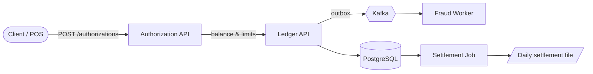

# Card Transaction Platform

[](https://github.com/renato-aq/card-transaction-platform/actions/workflows/ci.yml)

An event-driven card transaction platform built with **.NET 10** and **.NET Aspire**: real-time authorization,
a double-entry ledger, asynchronous fraud detection and a high-volume daily settlement batch.

> **Status:** work in progress. See the [roadmap](#roadmap).

## Architecture



| Service | Responsibility |
|---|---|
| **Authorization API** | Approves or declines card purchases with low latency; idempotent requests |
| **Ledger API** | Double-entry bookkeeping, balances, transactional outbox for events |
| **Fraud Worker** | Consumes transaction events and flags suspicious patterns |
| **Settlement Job** | Generates the daily settlement file in batches from the ledger |

Shared projects: `ServiceDefaults` (OpenTelemetry, health checks, resilience, service discovery) and
`Contracts` (integration events).

## Tech stack

- **.NET 10**, ASP.NET Core, Entity Framework Core
- **.NET Aspire** for local orchestration and observability dashboard
- **PostgreSQL**, **Kafka**
- **OpenTelemetry** (traces, metrics, logs)
- **xUnit**, WebApplicationFactory, Testcontainers
- **GitHub Actions** CI

## Getting started

Prerequisites:

- [.NET 10 SDK](https://dotnet.microsoft.com/download)
- A container runtime: [Docker Desktop](https://www.docker.com/products/docker-desktop/) or [OrbStack](https://orbstack.dev/)

Run the whole platform (PostgreSQL, Kafka and all services) with one command:

```bash
dotnet run --project src/CardPlatform.AppHost
```

The Aspire dashboard URL is printed in the console. Kafka UI is available from the dashboard.

Run the tests:

```bash
dotnet test
```

## Project structure

```
src/
  CardPlatform.AppHost/             Aspire orchestration
  CardPlatform.ServiceDefaults/     Shared observability, health checks, resilience
  CardPlatform.Contracts/           Integration events
  CardPlatform.Authorization.Api/
  CardPlatform.Ledger.Api/
  CardPlatform.Fraud.Worker/
  CardPlatform.Settlement.Job/
tests/
docs/adr/                           Architecture Decision Records
```

## Roadmap

- [x] Solution skeleton, Aspire orchestration, CI
- [ ] Ledger: double-entry accounts and transactions (EF Core + PostgreSQL)
- [ ] Authorization API: idempotent authorization flow
- [ ] Transactional outbox + Kafka integration events
- [ ] Fraud Worker: rule-based detection
- [ ] Settlement Job: batched file generation with before/after benchmarks
- [ ] Integration tests with Testcontainers
- [ ] Load tests with k6 and published results
- [ ] Kubernetes manifests

## Architecture decisions

See [docs/adr](docs/adr) for the reasoning behind the main technical choices.
